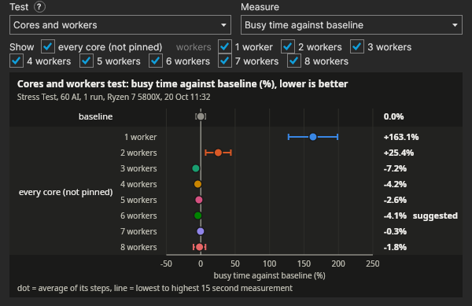
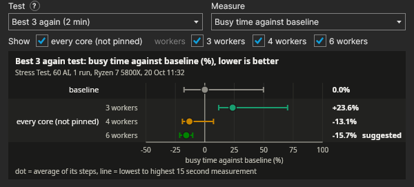
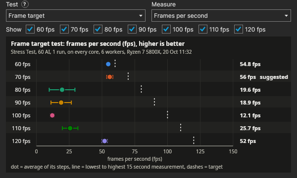
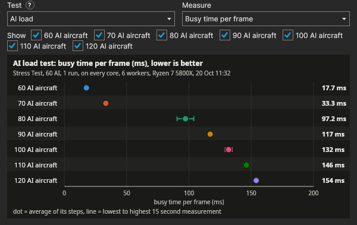

# Server tuning

This guide covers how a Nuclear Option dedicated server uses the CPU, the settings that change how it runs, and how
to find the right ones for your own machine with the Server Tester. The tester is a separate download for Windows and
Linux that runs a stress test on a private copy of the server and tells you which cores to give it, how many, and how
many physics workers to use.

## How the server uses the CPU

Almost all of the server's work happens on one thread, the main thread. Every frame it runs the AI pilots, the units,
the missiles, the objectives, the network and every plugin, one after the other. This is the thread that fills up
first, so the speed of one core matters far more than how many cores the machine has. A CPU with a high clock and a
large cache will run a busier server than one with twice the cores at a lower clock.

The physics runs at a fixed 60 steps a second whatever the frame rate is. The game splits each physics step into jobs
that run on worker threads, and the main thread waits for them to finish before it carries on. These workers are the
part of the server that uses more than one core, however, they only do the physics, so past a few of them the main
thread is waiting on its own work and not on theirs. The game picks the worker count itself at start-up: half the
threads the CPU has, between 2 and 8.

The frame target is how many frames a second the server tries to run. The game's own target is 60. Each frame the
server runs its scripts and sends its updates, then waits for the next frame, and that wait is the server's spare
time. A higher target lets a frame that finished early start sooner, given the physics stays at 60 a second either
way. When the spare time runs out, frames take longer than the target allows and players see it as jerky movement
and late hits.

### What the main thread does, and what the workers do

The main thread runs everything that is the game itself: every AI pilot's decisions and control inputs, missile
guidance, guns, turrets and radar, spawning and the faction HQs, the mission's objectives, reading and sending every
player's network messages, and every plugin. Unity runs all of the game's scripts on this one thread, so none of that
can be handed to another core.

The workers do the physics maths the game can split up. Sixty times a second the game's job manager hands them the
aerodynamic forces on every part of every aircraft, the control surfaces, the wheels and suspension of the ground
vehicles, the buoyancy of the ships and the line-of-sight checks for detection, and Unity's own physics engine
spreads its step over the same threads. The main thread starts all of those jobs, does one short piece of its own
work (the pilots' control inputs) and then waits until every job is finished before it carries on. The workers only
shorten that wait.

### Why not more workers?

Past a few workers there is nothing left for another one to do, and they start to cost the main thread:

- **The work runs out.** Each physics step is cut into a set number of batches (the line-of-sight checks go out 16 at
  a time, for example). Once every batch has a worker, an extra one has nothing to pick up.
- **The main thread waits for the last one.** Every worker has to be woken and handed its batch, so splitting the
  work finer adds overhead and saves nothing once the wait is already near zero.
- **They share cores with the main thread.** With more busy threads than free cores, the workers and the main thread
  take turns. With hyper-threading a worker can land on the other half of the main thread's own core and slow it.
- **The CPU clocks down.** A CPU boosts highest when only a few of its cores are busy, so every extra busy core can
  lower the clock the main thread gets, and the main thread is what sets the frame rate.

This is why the best worker count is usually about the number of fast cores left after the main thread's own,
capped at around four, and why two or three workers often measure the same as four. How much physics there is (AI,
vehicles, ships) and how fast each core is move it up or down, which is what the tester measures.

### Why a higher frame target helps, then stops helping

The server reads players' messages and sends out what it has queued once a frame, so a higher target answers
players sooner: every 16.7 ms at 60 fps, every 10 ms at 100. It also lets a frame that finished early start straight away instead of waiting
out its slot. However, the physics stays at 60 steps a second whatever the target, so a higher target doesn't make the
simulation itself any finer. The faster replies also stop mattering past a point: at 100 fps the server answers every
10 ms and at 144 fps about every 7 ms, so going from 100 to 144 saves at most about 3 ms a reply, which is very little
next to a player's ping of 30 to 200 ms.

Every extra frame costs CPU, given the scripts, the network and the plugins run once a frame. As the target goes up
the spare time goes down, and when it runs out the server can no longer hold its target: frames start to vary in
length, and a big fight or a mission load turns into stutter. A steady lower rate plays better than a higher one that
wobbles. The best target is the highest one the server holds at its busiest with room to spare, which is what the
tester's frame target test looks for: it suggests the highest target that held while leaving a quarter of each second
spare (you can change both).

## The settings

With the NukeStats plugin these are in `BepInEx/config/anz.nukestats.cfg` under `[Perf]`, to edit with the server
stopped, or in the dashboard's AI & Performance settings, where they take effect within a second.

| Setting | What it does |
|---|---|
| `JobWorkers` | How many worker threads run the physics jobs. 0 leaves it to the game. |
| `TargetFps` | The frame rate the server aims for while a mission runs. 0 leaves the game's 60. Without NukeStats, the server's `-limitframerate` start option does the same. |
| `SkipPilotAnimation`, `SkipVisualConstraints`, `SkipVisualEffects`, `SkipServerParticles` | Stop work on the server that only changes how things look (pilot models, ship wake, smoke and sparks). Nobody sees the server's own picture, so this is time back for nothing. |

More workers than the server needs only use more CPU, and on a shared machine that CPU comes out of everything else
running on it. A higher frame target costs CPU every frame, so set it to what your server holds at its busiest, not
what it holds when it is quiet.

## The Server Tester

Download `Nuclear-Option-Server-Tester-<version>-windows.zip` or `-linux.zip` from [the Server Tester's releases](https://github.com/Tomosnuclearbombos/nuclear-option-tester/releases), extract it
anywhere and run `ServerTester` (`ServerTester.exe` on Windows). Nothing is installed: everything it keeps goes in a
`data` folder next to it, and deleting the folder removes it.

The first time it opens, with no results yet, it says how it works and offers to take a baseline: the Stress Test on
the server exactly as it runs when you install it, on every core with the game's own physics workers. If you won't run
your server on every core, or not on the efficient ones, you can pick the cores there. **TAKE A BASELINE** installs the test server if it isn't there
yet and runs it, which takes about ten minutes plus the download. It's worth having before anything else, given the
core count and physics worker tests are measured against it, and later tests opened next to it on the graph can be set
against it too.

1. **INSTALL.** The tester downloads its own private copy of the dedicated server from Steam (about 1 GB) with
   Valve's SteamCMD, and puts BepInEx, a test build of NukeStats and its two test missions on it. It never touches a
   server you already run. The test server is hidden, has a random password and uses ports 7790 and 27030.
2. **TEST CORE SPEEDS.** About half a minute. One core at a time runs the same work, so the tester knows which
   cores are fastest. On a hybrid Intel CPU this also shows the fast and efficient cores apart, which matters because
   the server should never run on the efficient ones. Untick any core in the list you won't give your server: the core
   count tests then count up through the ones ticked, fastest first.
3. **Pick the test mission.** Both are the game's Escalation on its own map, with a fixed AI load the tester sets
   (60 AI aircraft unless you change it: a quarter BDF, three quarters PALA, with PALA flying at double skill), so
   every machine is tested with the same work. More AI gives the physics workers more to do and shows their
   differences better, however, it also asks more of the CPU.
   - **Stress Test** is for finding your settings. It has aircraft only: no ground vehicles, ships or anti-aircraft,
     and guns as the only weapons, so the AI fight each other and land to rearm, nothing can end the mission and the
     load stays steady from one run to the next.
   - **Realistic Benchmark** is for checking your settings in a real battle once the Stress Test has found them. It
     is the full Escalation, set up as co-op on the BDF side, with every ground unit and ship. It is busier and less
     steady, and a side can win: the mission then loads again and the tester repeats the step it was on.
4. **Pick the automated test, or the tests yourself.**

   #### The automated test

   The **automated test** runs it all in rounds, each on the best of the last:
   - **Baseline** first, as above.
   - **Round 1** (always alternating with baseline): every core count, from 1 up to every fast core ticked and then
     all the ticked cores together, with every physics worker count from 1 to 8, each compared with the baseline. On a
     CPU with 6 fast and 8 efficient cores that is 7 core counts and 56 pairs.
   - **Round 2**: every frame target in the range, each measured on the cores and workers picked, then the best one.
   - **Round 3**: the AI load on both picks.

   For rounds 1 and 2 you choose before it starts whether it picks the best itself and goes on, or stops when the
   round is done and lets you pick, with that round on the graph. Its own pick is the fewest cores and workers within
   the noise of the best (never fewer than 2 workers), and the highest frame target held with the spare time you set.

   #### Picking the tests yourself

   **Pick the tests myself** runs only the ones you tick:
   - **Baseline**, as above. If your server won't run as installed, pick the cores and workers it will have. Every
     other test runs on the baseline too, apart from the one thing it tests.
   - **Core count** runs the server on 1, 2, 3 and more of the fastest cores (both threads of each), and on a hybrid
     CPU also on every core together.
   - **Physics workers** runs 1 to 8 workers (up to one less than the CPU's threads, on a CPU with 8 threads or
     fewer).
   - **Frame target** measures every target from where it starts to the top. You choose the targets to try (60 to
     240) and how much spare time the suggestion has to leave. A target the server can't hold doesn't stop it, given a
     higher target still lifts the frame rate. The suggestion is the highest held with that spare time, else the
     highest held, else (none held) the one that gave the highest frame rate.
   - **AI load** adds AI aircraft a step at a time (60 to 120, ten at a time, unless you change it), measures every
     load, and says how far the frame rate held. It runs once,
     at the end, given AI that is already up can't be taken away, so with other tests ticked it starts no lower than
     the AI aircraft they ran with.
5. **Pick the order** (tests picked by hand; the automated test always alternates).
   - **Alternate with a baseline** runs each setting and then the baseline (1, b, 2, b, 3, b ...), with the baseline
     test's own step before the first. Each setting is
     then compared with the baseline steps either side of it, so a slow drift over the test (the CPU heating up, or
     the mission getting busier as it goes) cancels out. This is the more accurate order.
   - **One after another** runs them in order (1, 2, 3, 4 ...) and takes about half as long.
6. **Pick how many times to run the whole test**, start to finish. More runs make the core and worker results
   surer, given a difference only counts when it is bigger than how much the same setting moved between its runs. A
   frame target only counts as held when it held in every run.
7. **Press START** and leave the machine alone. Anything else busy on it takes time from the test server, and the
   tester warns about anything it finds using the CPU when it starts. CANCEL stops the test and keeps what it has
   measured so far.

Every step measures for 30 seconds (two 15-second measurements; **Seconds per step** makes it longer) after the one
where the setting changed, and only counts them once the setting has taken, the AI is up and nobody is connected. The
tester shows how long the whole test will take before it starts: the automated test takes about two hours on a
14-core CPU.

### Reading the results

The tester has one graph, laid out like a table. Pick a test above it and the measure to show, then tick the settings
you want, for example 2, 3 and 4 workers. The baseline is the first row, then the settings run down the side, a row
each, and the measure runs along the bottom: the dot is the average of that setting's steps, the line runs from its lowest 15-second measurement to its
highest over every run of the test, and the average is written at the end of the row with "suggested" against the
setting the tester suggests. Each setting has its own colour and the baseline is grey. When two lines overlap a lot,
the difference is within the test's own wobble, which the tester counts as a tie. On the frame target test a short
dash marks each target: held on the average, a target holds while its dot sits on its dash; held on the 5% or 1% lows,
it needs 90% or 80% of it.

These are from an automated test at 60 AI on a rented Ryzen 7 5800X:

*The cores and workers test. 1 and 2 workers were well behind, 3 to 8 sat close together, and the tester suggested 6.*

*The best 3 measured again for 2 minutes, where 6 workers held up best.*

*The frame target test, with a dash for each target. The rented host got busy partway through this one, which is why 80 to 110 fall well short.*

*The AI load test, with the busy time per frame climbing as the AI goes up.*

**Open results** lists the tests in `data/results`, each saying what it tested and its settings, and puts the ones you
tick on the graph, up to eight. **Other folder...** lists the tests somewhere else, results copied from another PC
for example. Each test's chip says what it tested and its settings (the mission, the AI
load and the runs), and ticking more than one test of the same kind compares them: each setting then gets a row for
each test, named by its settings and anything else that differs between them (the order, the baseline, the PC).
Tests whose baselines ran the same (the same PC, system, mission, AI, cores, workers and compare frame rate) share one baseline row, the
average of them all. When they didn't, the tester asks which one is the baseline, and the other tests are set against
that one's average. The **Baseline** graph shows the baselines themselves, a row for each different one.
Every option in the tester has a **?** to hover that explains it. The
measures are:

- **Busy time per frame**, the milliseconds the main thread worked for each frame. Cores and workers are compared at
  one fixed frame target (60 unless you change it), so every second asks the server for the same work and a lower
  number means that setting leaves more room.
- **Busy time against baseline**, the same set against the baseline steps either side of it, in percent: +9%
  means the main thread worked 9% more for each frame than with the baseline. This is what the tester judges cores
  and workers by, given it leaves out the drift over the test.
- **Frames per second**, which sits at the target while the server holds it, and below it when it can't.
- **5% low** and **1% low frame rate**, the frame rate of the slowest 5% and 1% of frames, and the **longest frame**
  in milliseconds. The average can hold a target while a few long frames still show as stutter; these show them.
  In the advanced options a frame target can count as held on the 5% or 1% lows instead of the average (they sit a
  little under the target even when it holds easily, so they have their own share of it to reach).
- **Physics time** and **spare time**, milliseconds of each second spent in the physics step and with nothing to do.
- **Server CPU use**, the whole server's use, where 100% is one core kept busy.

A setting only counts as better when it beats the others by more than the same setting varied between its own runs,
which is why it can say three cores are enough on a CPU with sixteen. Of the settings that tie, the tester suggests
the fewest cores and the fewest workers, given more only use more CPU, but never fewer than 2 workers, the game's
own least. The results are relative: an empty test server
with a fixed AI load does different work to a full match with players, so use them to pick the cores and workers,
and check the frame target on a busy night.

When the CPU was held back during a step, by heat or a power limit, the report lists that step (on Linux this is read
from Intel CPUs only). That moves the numbers more than any setting does, so if
many steps were held back, sort the cooling or the power settings out and test again.

### Applying the results

The tester saves `results.json`, `measurements.csv` and `report.txt` in `data/results/<date>`, with the test
server's own logs beside them (`server-console.log` and `server-bepinex.log`, which say why if the test server
stopped on its own), and **Apply results** shows three ways to use them:

1. **The NukeStats dashboard.** In Game Settings press **Apply Server Tester results** and pick `results.json`. It
   shows the current and suggested values and applies them on Apply, no restart.
2. **By hand**, the `[Perf]` lines to put in the plugin's config.
3. **The CPUs**, for a server on the same machine. On Windows, start the server from a `.bat` file with
   `start "" /affinity <mask> NuclearOptionServer.exe ...` (the tester gives the mask). On Linux, a systemd service
   takes `systemctl set-property <service> AllowedCPUs=<cpus>`, and a script takes `taskset -c <cpus>` in front of
   the start line. **Pin a server running on this PC now** does it straight away, until that server restarts. It
   is only there when the results came from a PC with the same CPU and system as the one you are on, given CPU
   numbers differ from one PC to the next, and Windows and Linux number them differently.

Run the tester on the machine the server runs on, given the results belong to that CPU. A rented server with no
desktop can't run it, so on one of those use the settings above with care and watch the server's own numbers.

## Keeping the server's cores to itself

Pinning keeps the server on its cores, but on Windows it does nothing to keep other programs off them, and a browser
on the same cores as the server's main thread can cost a fifth of its speed. Close what you can while players are on.
On Linux, `systemctl set-property` on `system.slice`, `user.slice` and `init.scope` with the remaining CPUs keeps
everything else off.

On a hybrid Intel CPU (12th gen and later) keep the server on the fast cores only, with both threads of each. When
a fast core gets hot the CPU can move the main thread to an efficient core, and the server slows right down. On Linux,
`intel-lpmd` and `ananicy-cpp` rewrite CPU sets and process priorities by themselves and quietly undo pinning, so
turn them off on a server.

## Power settings

A CPU saving power holds its clock down, and the main thread is the first thing to feel it. The tester switches to
a high performance setting for the test and puts yours back after.

- **Windows:** the High performance (or Ultimate performance) power plan while players are on.
- **Linux:** `powerprofilesctl set performance` while players are on. The `powersave` governor on intel_pstate and
  amd-pstate-epp is normal and not slow; the energy preference is what matters.
- **Laptops and mini PCs** run hotter and have lower power limits than a desktop. The report shows the clock the main
  thread really ran at and the CPU's temperature for each step.

## Linux notes

- The server writes its start time in the machine's own date format, and tools that read the log expect the US
  format. Set `TZ=UTC` and `LC_ALL=C.UTF-8` in the server's environment (a systemd service:
  `Environment=TZ=UTC LC_ALL=C.UTF-8`).
